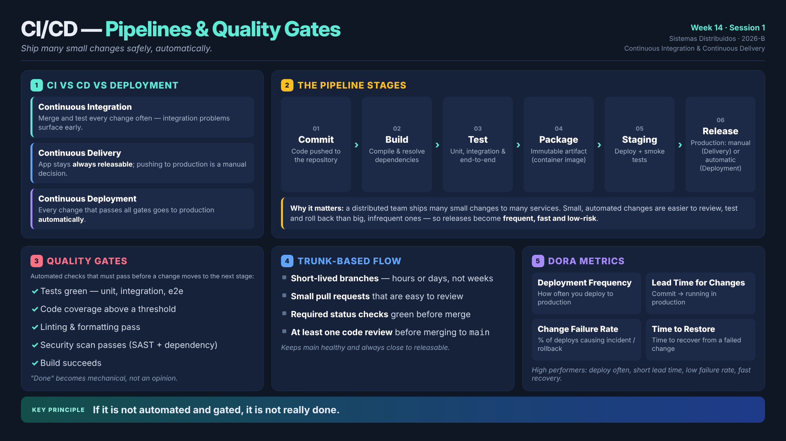

# Week 14 · Session 1 — CI/CD: Pipelines and Quality Gates

> **Course:** Sistemas Distribuidos (2026-B, G1)
> **Topic:** Continuous Integration and Continuous Delivery
> **Core idea:** *ship many small changes safely, automatically.*

---

## 1. What this session is about

When a distributed team works on many services at once, the only sustainable way to deliver is through a stream of **small, safe changes**. CI/CD is the practice that makes this possible. In this session we look at:

- how CI, Continuous Delivery and Continuous Deployment differ;
- the **stages** a pipeline runs through;
- the **quality gates** that turn "done" into something a machine can verify;
- **trunk-based development** backed by pull-request checks;
- the **DORA metrics**, which show whether delivery is actually healthy.

---

## 2. Three terms that are easy to mix up

| Practice | What it means | Who pushes to production? |
|---|---|---|
| **Continuous Integration (CI)** | Every change is merged and tested frequently — ideally several times a day — so integration problems appear early. | — |
| **Continuous Delivery (CD)** | The application is kept **releasable at all times**: anything that passes the pipeline could be deployed. | A person (manual decision) |
| **Continuous Deployment** | One step beyond CD: every change that clears all the gates is **released automatically**. | The pipeline (no manual step) |

---

## 3. Why bother?

Distributed teams ship lots of small changes across lots of services. When integration, testing and release are automated, releases become **frequent, fast and low-risk**. A small automated change is simply easier to review, test and roll back than a large one that ships rarely.

---

## 4. Stages of a pipeline

A typical CI/CD pipeline moves through these steps, one after the other:

| # | Stage | What happens |
|---|---|---|
| 1 | **Commit** | The code is pushed to the repository. |
| 2 | **Build** | The code is compiled and its dependencies resolved. |
| 3 | **Test** | Unit, integration and end-to-end tests run. |
| 4 | **Package** | An immutable artifact is produced (for example, a container image). |
| 5 | **Deploy to staging** | The artifact goes to a staging environment and smoke tests run. |
| 6 | **Release to production** | Manual under Continuous Delivery; automatic under Continuous Deployment. |

---

## 5. Quality gates

A **quality gate** is an automated check that must pass before a change can advance to the next stage. Typical gates:

- ✅ All tests green (unit, integration, e2e)
- ✅ Code coverage above a defined threshold
- ✅ Linting and formatting pass
- ✅ Security scan passes (SAST and dependency scan)
- ✅ The build succeeds

With gates in place, "done" is no longer a matter of opinion — a change only moves forward once the machine confirms every check is satisfied.

---

## 6. Trunk-based flow with PR checks

Modern teams tend to work in a **trunk-based** style:

- Branches live for **hours or days**, not weeks.
- Pull requests are **small** and easy to review.
- **Required status checks** must be green before a merge.
- At least **one code review** is needed before merging into `main`.

The result: `main` stays healthy and is always close to being releasable.

---

## 7. Measuring delivery: the DORA metrics

The DevOps Research and Assessment (DORA) program defines four metrics for judging delivery health:

| Metric | What it measures |
|---|---|
| **Deployment Frequency** | How often you deploy to production. |
| **Lead Time for Changes** | How long a change takes from commit to running in production. |
| **Change Failure Rate** | The percentage of deployments that cause a failure (incident or rollback). |
| **Time to Restore Service** | How long it takes to recover after a failed change. |

High-performing teams deploy often, have short lead times, keep failure rates low and recover quickly.

---

## 8. Key principle

> **If it is not automated and gated, it is not really done.**

Counting on people to remember every check doesn't work reliably. Encoding those checks as pipeline gates makes quality consistent and repeatable.

---

## 9. OptiView mapping (Week 14)

OptiView already applies **CI on pull requests** — for example, `opti-front` runs `.github/workflows/ci.yml` on `develop` / `qa` / `main` with the sequence install → test → build. It also has a **package step** (`.github/workflows/publish.yml`) that pushes container images to **GHCR** whenever `develop` advances. This keeps every service close to releasable, while promotion to `qa`/`main` remains a deliberate **Continuous Delivery** decision made through Git Flow PRs.

DORA direction for the team:
- many small `feat/*` PRs;
- short lead time through GHCR + Compose;
- low change-failure rate thanks to rollback to a previous SemVer version.

---

## 10. Conclusions

- **CI** integrates and tests changes frequently; **Continuous Delivery** keeps the app always releasable; **Continuous Deployment** releases to production automatically.
- A pipeline flows **Commit → Build → Test → Package → Deploy → Release**.
- **Quality gates** make "done" a mechanical decision instead of an opinion.
- **Trunk-based development** with required PR checks keeps `main` healthy.
- **DORA metrics** — frequency, lead time, failure rate and restore time — tell you how healthy your delivery really is.
