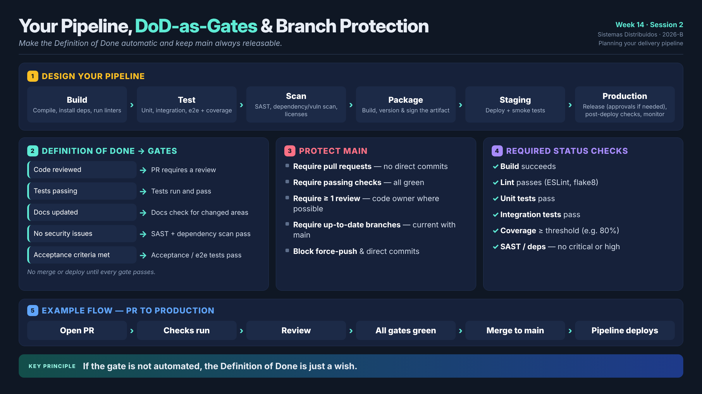

# Week 14 · Session 2 — Your Pipeline, DoD-as-Gates and Branch Protection

> **Course:** Sistemas Distribuidos (2026-B, G1)
> **Topic:** Planning your delivery pipeline
> **Core idea:** *make the Definition of Done automatic and keep the main branch always releasable.*



---

## 1. From concepts to your own pipeline

Session 1 covered the theory of CI/CD; understanding it isn't enough on its own. This session is about putting it into practice:

1. designing **your own pipeline**;
2. converting your **Definition of Done** into automated gates;
3. protecting `main` so that quality is enforced by the machine.

---

## 2. Designing the pipeline

Decide which concrete stages your project needs and what each one is responsible for:

| Stage | What it runs |
|---|---|
| **Build** | Compiles the code, installs dependencies and runs linters. |
| **Test** | Runs unit, integration and end-to-end tests and collects coverage. |
| **Scan** | Runs SAST and dependency/vulnerability scans and checks licenses. |
| **Package** | Builds the artifact (e.g. a container image), then versions and signs it. |
| **Deploy to staging** | Deploys to a staging environment and runs smoke tests. |
| **Deploy to production** | Releases (with approvals if required), runs post-deploy checks and monitors. |

---

## 3. The Definition of Done (DoD)

The **DoD** is the checklist the whole team agrees a change must satisfy before it counts as "done":

- Reviewed by at least one qualified reviewer.
- Tests written and passing (unit and integration).
- Documentation updated (README, API docs, ADRs).
- No known security problems (no critical or high findings in the code or its dependencies).
- Acceptance criteria met.

Having one shared DoD avoids the situation where "done" means something different to each person.

---

## 4. Turning the DoD into gates

Each DoD item becomes an **automated check** in the pipeline, so "done" is enforced by the machine rather than by opinion:

| DoD item | Automated check |
|---|---|
| Code reviewed | The PR requires a review. |
| Tests passing | Tests run and pass. |
| Docs updated | Docs are updated (or a check runs for the changed areas). |
| No security issues | Security scan passes (SAST, dependency). |
| Acceptance criteria met | Acceptance / e2e tests pass. |

**No change can be merged or deployed until every gate has passed.**

---

## 5. Branch protection rules on `main`

Protect `main` with rules like these:

- **Require pull requests** — every change goes through a PR; no direct commits.
- **Require passing status checks** — every required check must be green.
- **Require at least one review** — ideally from a code owner.
- **Require up-to-date branches** — the PR has to be current with `main`.
- **Block force-pushes and direct commits** — the history stays protected.

---

## 6. Required status checks

These are the specific checks that must be green before a merge is allowed:

- ✅ **Build** — the project builds successfully.
- ✅ **Lint** — the code passes linting (e.g. ESLint, flake8).
- ✅ **Unit tests** — all of them pass.
- ✅ **Integration tests** — all of them pass.
- ✅ **Coverage** — at or above the minimum threshold (e.g. ≥ 80%).
- ✅ **SAST / dependency scan** — no critical or high issues in the code or its dependencies.

---

## 7. A change from PR to production

```
Open PR → Checks run → Review → All gates green → Merge to main → Pipeline deploys
```

1. **Open PR** — the change is proposed.
2. **Checks run** — the pipeline executes the required checks.
3. **Review** — a reviewer approves.
4. **All gates green** — every check has passed.
5. **Merge to main** — the change lands in `main`.
6. **Pipeline deploys** — CI/CD deploys from `main`.

---

## 8. Key principle

> **If the gate is not automated, the Definition of Done is just a wish.**

A DoD that depends on people remembering to check things will drift over time. Gates wired into branch protection and the pipeline are what make it real.

---

## 9. OptiView mapping (Week 14)

An OptiView slice counts as **done** when it has:

- a Conventional Commit message;
- a reviewed PR;
- **CI green** on the target environment branch;
- no secrets in the diff;
- for platform cuts, one PR per environment.

Branch protection should require these status checks on `develop` / `qa` / `main` and block force-pushes.

**Gaps to close (backlog):**
- uniform required checks across all 19 `opti-*` repositories;
- coverage and SAST as **blocking** gates;
- image digests / SemVer tags in GHCR instead of only `:latest`.

---

## 10. Conclusions

- Design concrete pipeline stages for your project and define what each one runs.
- Write a shared **Definition of Done** and convert every item into an **automated gate**.
- Protect `main` with **branch protection rules** and **required status checks**.
- Follow the flow **open PR → checks → review → gates green → merge → deploy**.
- A gate that isn't automated is only a wish.
