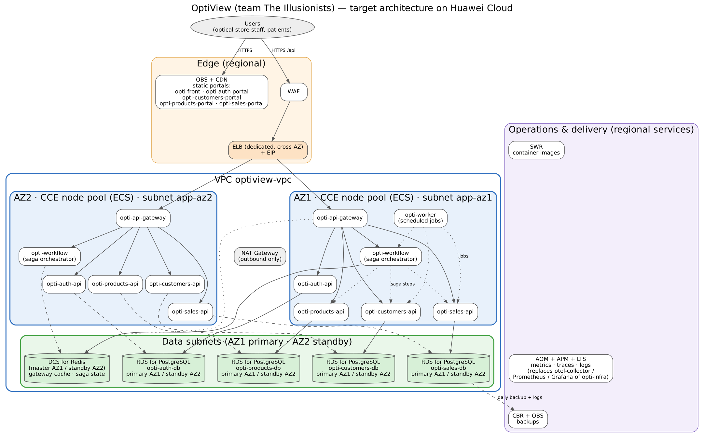

# Architecture design note — The Illusionists

## 1. Target architecture

OptiView is the system our team builds for optical stores: it manages patients (customers), frames and lenses (products), work orders and sales. Today the whole platform runs on a single Docker host per environment, with one PostgreSQL instance and the observability stack (OpenTelemetry collector, Prometheus and Grafana) running as containers next to the services. In the target design for Huawei Cloud, every repository of the team becomes a container workload in a CCE cluster whose node pools are spread over two availability zones (AZ1 and AZ2) inside one VPC. Public traffic enters through WAF and a dedicated ELB with an EIP, which sends requests to `opti-api-gateway` in both zones. The gateway routes to the domain APIs (`opti-auth-api`, `opti-customers-api`, `opti-products-api`, `opti-sales-api`) and to `opti-workflow`, which runs the place-order and cancel-order sagas. `opti-worker` runs the scheduled jobs. Each `-db` repository becomes its own RDS for PostgreSQL instance with the primary in AZ1 and a synchronous standby in AZ2. Redis moves to DCS in master/standby mode and keeps the gateway cache and the saga state. The five web portals are static builds, so they are served from OBS behind CDN and never touch the VPC.

| Component in the diagram | Defined in (file of your team's -docs) |
|---|---|
| opti-api-gateway | `09-microservices/services/01-api-gateway/README.md` |
| opti-auth-api, opti-auth-db (RDS) | `09-microservices/services/02-auth-service/README.md` |
| opti-sales-api, opti-sales-db (RDS) | `09-microservices/services/03-sales-service/README.md` |
| opti-customers-api, opti-customers-db (RDS) | `05-architecture/overview.md` (section 4, service ↔ repository mapping) and `06-data/models.md` (`patients_schema`) |
| opti-products-api, opti-products-db (RDS) | `05-architecture/overview.md` (section 4) and `06-data/models.md` (`inventory_schema`) |
| opti-workflow, opti-worker | `05-architecture/overview.md` (section 4) and `05-architecture/decisions/records/ADR-004-place-order-saga.md` |
| DCS for Redis (gateway cache, saga state) | `09-microservices/service-catalog.md` |
| Portals on OBS + CDN (opti-front, opti-auth-portal, opti-customers-portal, opti-products-portal, opti-sales-portal) | `05-architecture/overview.md` (section 2, clients) |
| ELB, CCE node pools, topology per environment | `05-architecture/deployment.md` |
| AOM, APM and LTS (observability) | `13-operations/observability.md` |

## 2. Five principles

| Principle | Current weakness | Evidence in -docs | Design decision | Huawei Cloud service |
|---|---|---|---|---|
| Reliability | Every environment runs on one Docker host, so if that host fails the whole store stops working. | `05-architecture/deployment.md` | Run at least two replicas of every API, one per AZ, behind a load balancer, and put every database in a primary/standby pair across AZs. | ELB, CCE (node pools in AZ1 and AZ2), RDS for PostgreSQL primary/standby |
| Security | Secrets such as `JWT_SECRET` and `DATABASE_URL` are expected to live in a vault that does not exist yet, and the gateway is exposed directly. | `10-devops/environments.md` | Keep all secrets in a managed secret store injected at runtime, and filter public traffic before it reaches the gateway. | DEW (CSMS + KMS), WAF |
| Performance efficiency | The gateway has no decided cache; Redis is only a candidate for counters. | `09-microservices/service-catalog.md` | Use a managed Redis for the gateway cache and rate-limit counters so repeated reads do not hit PostgreSQL. | DCS for Redis |
| Cost | The scalability requirement is still a pending team decision, so the only safe option today is a host sized for the peak. | `04-requirements/non-functional.md` (NFR-003) | Scale the APIs between 2 and 3 pods by CPU, and serve the portals as static files instead of running containers for them. | CCE with HPA and Cluster Autoscaler, OBS + CDN |
| Operations | Logs, metrics and traces depend on containers we operate ourselves (otel-collector, Prometheus, Grafana) on the same host they monitor. | `13-operations/observability.md` | Send telemetry to managed services that do not die with the host and keep the existing trace and correlation ids. | AOM, APM, LTS |

## 3. Scalability

Our non-functional requirement NFR-003 already defines the rules: horizontal scaling when CPU goes above 70%, a reaction in less than two minutes, and up to three instances per service, because OptiView serves one optical store per deployment. All APIs are stateless (the saga state lives in Redis), so pods can be added or removed without losing sessions. I chose the two services that receive most of the traffic.

| Service | Scaling metric | Threshold (number and unit) | Min instances | Max instances |
|---|---|---|---|---|
| opti-api-gateway | Average CPU utilization of the pods | 70 % for 2 minutes | 2 | 3 |
| opti-sales-api | Average CPU utilization of the pods | 70 % for 2 minutes | 2 | 3 |

The minimum is 2 so that each AZ always has one pod; the maximum is 3 because that is the limit in NFR-003. If the pods cannot be placed, the CCE Cluster Autoscaler adds an ECS node in the zone that needs it.

## 4. Disaster recovery

- Critical data store: `opti-sales-db` (RDS for PostgreSQL), because it holds quotations, work orders and payments; losing it means losing the store's revenue history.
- RTO: 5 minutes
- RPO: 0 minutes (NFR-008 asks for less than 1 second)
- DR pattern (chapter 11): active-standby across two availability zones in the same region (RDS primary in AZ1, synchronous standby in AZ2 with automatic failover), plus daily automated backups to OBS for logical errors.
- Why the pattern meets those numbers: Because the standby receives every transaction synchronously before the commit is confirmed, no confirmed sale is lost when the primary fails, which gives an RPO of zero. RDS detects the failure and promotes the standby automatically in less than a minute, and since the services connect through the same RDS address, they reconnect without manual steps, which keeps recovery inside the 5-minute RTO.

A daily backup alone would not be enough: it could lose up to 24 hours of sales, far from the target in `04-requirements/non-functional.md` (NFR-008). The backups are still kept, but only to restore data after a human or software mistake that the standby would copy too.

## 5. Automated deployment

Each repository already has GitHub Actions workflows. The design keeps them and only changes where the image goes and where it runs: images are pushed to SWR and deployed to CCE.

| Stage | Trigger | Tool or service | File in your team's repositories |
|---|---|---|---|
| Build | Pull request to `develop`, `qa` or `main` | GitHub Actions, Maven (`mvn -B verify`) | `opti-sales-api/.github/workflows/ci.yml` |
| Test | Same pull request (unit and integration tests in the verify phase) | GitHub Actions, Maven, JUnit | `opti-sales-api/.github/workflows/ci.yml` |
| Image | Push (merge) to `develop` | Docker Buildx, pushed to SWR | `opti-sales-api/.github/workflows/publish.yml`, `opti-sales-api/deploy/Dockerfile` |
| Deploy to qa | Merge to `qa` | CCE workload updated with the new image tag; Flyway migration job first | `opti-sales-api/deploy/compose.yml`, `opti-sales-db/.github/workflows/db-ci.yml` |
| Deploy to production | Merge to `main` after approval | CCE rolling update across both AZs | `opti-infra/compose.yml` |
| Rollback | Failed health check or manual decision | CCE rollback to the previous image tag | `opti-docs/05-architecture/deployment.md` (section 6) |

Database migrations run before the new API version because the `-db` repositories are Flyway images (`opti-sales-db/deploy/Dockerfile`). Migrations must stay backward compatible so that a rollback of the API does not need a rollback of the schema.

## 6. Decisions

- [ADR-C3-01](ADR-C3-01.md): Use RDS for PostgreSQL with a synchronous standby in a second availability zone for every OptiView database.
- [ADR-C3-02](ADR-C3-02.md): Run OptiView services on CCE across two availability zones with CPU-based horizontal autoscaling.
